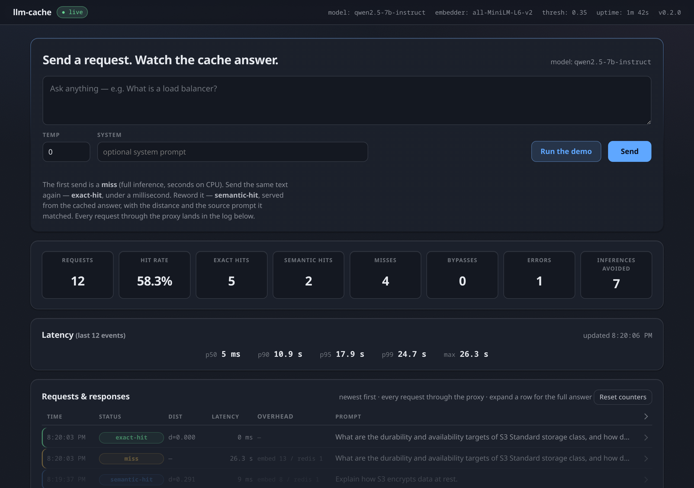

# llm-cache

A **governed response cache** in front of a local LLM. Requests that can be answered
without the model are; requests that cannot are verified before they are reused.

The premise: *inference is the expensive part, and most of it is avoidable.* A 7B model on
a CPU box takes **6–20 seconds** per answer. A cache hit on this project takes **0.4–14 ms**.
The whole design is about making the second number the common one.



*One run of the demo, live: **p50 5 ms** against **p99 24.7 s**. The gap is the product.*

This is being built as the **preview for the JEE AI Tutor content-creation SOP**
([`docs/REBUILD.md`](./docs/REBUILD.md)). The dashboard — kept from the previous build
because it was good — is **frozen**, and the backend is written to its contract
([`docs/UI-CONTRACT.md`](./docs/UI-CONTRACT.md)).

---

## The preview, in one run

```bash
node scripts/demo_preview.mjs
```

```
1. deterministic tier — a template answered by CODE
  template T-EC2-COST    deterministic-hit      0.5 ms  deterministic:T-EC2-COST
     answer: $280.32 for the month
  same template, 160h    deterministic-hit      0.5 ms  differ from 730h by ONE number
     answer: $61.44 for the month
     correct: $61.44, NOT the 730h answer

2. exact tier — a byte-identical request
  first ask              miss               6267.5 ms
  identical re-send      exact-hit             0.6 ms
  with top_k=1           miss               6144.6 ms  different param -> must not be a hit

3. semantic tier — a rewording (the model is still stopped)
  rewording              semantic-hit         14.1 ms  from: "What is S3 storage classes?"

4. miss — the one request that genuinely needs the model
  genuinely new          miss              16429.0 ms
  asked again            exact-hit             0.4 ms

  model invocations for the whole run : 3
  requests that never touched the model: 5 of 8 (63%)
```

Read it as three separate claims:

1. **A template is answered by code** — 0.5 ms, and the answer is *correct by construction*.
   The same template with one parameter changed produces a different answer, because the
   cache key is `(template, parameters)`, not the prompt text.
2. **A byte-identical request is a hit** — 0.6 ms — but a request that differs in
   `top_k` is **not**, even though the text is identical.
3. **A rewording is a hit** — 14.1 ms — after the *whole conversation* is embedded and the
   candidate is **verified**. The verifier rejected 2 candidates during this run; those
   were served from inference instead of silently reused.

---

## The three tiers

| Tier | Key | Cost | Model? | When |
|---|---|---|---|---|
| **0 · deterministic** | `(template_id, parameters)` | **0.3 ms** | **no** | the SOP says *"Start with deterministic templates whenever the answer can be computed from controlled parameters"* (line 595) |
| **1 · exact** | sha256 of model + messages + **every answer-affecting param** | **0.6 ms** | **no** | byte-identical request |
| **2 · semantic** | embedding of the **whole conversation**, vector search **pre-filtered by scope**, then **verified** | **8–14 ms** | **no** | a rewording of the same question in the same scope |
| **miss** | — | 6–20 s | **yes** | genuinely new work |

### The domain guard

The model card for this fine-tune promises it *"refuses questions outside the AWS domain by
design"* and reports **100% correct refusal**. Measured on this build, that promise does not
hold — the adapter learned the AWS *style* but not the refusal:

```
"What is the boiling point of water in Celsius?"  ->  "The boiling point of water in Celsius is 100 degrees."
"Who wrote the play Hamlet?"                      ->  "Hamlet was written by William Shakespeare."
```

**0 of 6** out-of-scope questions refused. So the proxy enforces the promise instead, before
any tier can serve or store an answer:

```
$ curl -s -w " [%{http_code}]" -X POST localhost:8000/v1/chat/completions \
    -H 'Content-Type: application/json' \
    -d '{"model":"qwen2.5-7b-instruct","messages":[{"role":"user","content":"Who wrote the play Hamlet?"}]}'
{"detail":"This assistant only answers questions about Amazon Web Services — …"} [422]
```

The classifier is a **hybrid** — semantic similarity to domain exemplars catches paraphrases
that avoid jargon, domain vocabulary catches the rest. Neither works alone: the semantic
signal alone *overlaps* (lowest in-domain score 0.117, highest out-of-domain score 0.125).

The domain comes from the **corpus**, so swapping the AWS corpus for the JEE *Sets* chapter
swaps the domain with it. `DOMAIN_MODE` is `strict` (refuse), `bypass` (answer, label, never
cache) or `off`.

### Grounding: the RAG the checkpoint does not contain

The model card credits the fine-tune with *"grounded, accurate responses"* — but
attributes that to a **FAISS layer over 211 scraped AWS doc chunks, which is not part of the
checkpoint**. Without it the model answers from parametric memory:

```
"What are virtual machines?"
  before -> "Virtual machines (VMs) are computer systems that run on a physical server
             using virtualization technology..."          (no mention of EC2)
  after  -> "Virtual machines in AWS are instances of EC2, which are resizable virtual
             servers. They run on a physical host and are created from an Amazon Machine
             Image (AMI)..."                              (+ source, + caveats)
```

So grounding is rebuilt from a knowledge base that ships with the repo
(`knowledge/aws-knowledge.json` — 53 curated, citable AWS chunks). The same MiniLM embedder
that serves the semantic cache serves the retrieval, so there is no second model and no second
toolchain. Retrieved chunks go into the system prompt with their source, and the answer is
asked for a direct sentence, 3–5 specific bullets and a caveat.

The context window had to grow from 512 to **2048**: three chunks plus a question plus a full
answer is ~1600 tokens, and the 512-token window rejected the request outright. The KV cache
cost of 2048 is ~115 MB.

### Making the answers bigger — and not making them up

Asking for more made the model **fabricate**:

```
"aws", asked for six to nine bullets, produced
  - AWS offers an EC2 instance type called 't2.micro' which is free-tier eligible
  - These instances are billed at a rate of $0.0000002 per second
```

None of that is in the reference material. It reads well and it is false — exactly what the SOP
forbids. So bigger answers needed two things: **more true material**, and **a check that the
answer stays true**.

**More material.** The knowledge base grew to **53 chunks**, and retrieval now expands within the
top chunk's *topic* — a question about EC2 gets the other EC2 chunks (instance types, storage,
networking, pricing) as complementary detail, rather than three unrelated chunks. A question
about S3 gets the rest of S3.

**A check.** Every generated answer is compared against the reference material it was given. The
signal is *specific identifiers*, not vocabulary:

| | grounded | fabricated |
|---|---|---|
| novel identifiers | none | `t2.micro`, `RunInstances`, `$0.0000002`, `EC2` |

Generic words like "console path" or "API action" are ignored — the instruction asks for them, so
their absence from the source is not evidence of anything. An answer that fails the check is
retried **closed-book** ("answer from the reference material and nothing else"), and if it still
fails it is **not cached** and the request errors.

### More than one question in a message

Three phrasings are recognised as several questions, not one:

```
tell me about AWS
tell me about EC2              -> two intents (newline)
What is AWS? What is EC2?      -> two intents (question marks)
tell me about AWS and EC2      -> two intents (coordinated topics)
tell me about AWS, EC2 and S3  -> three intents
```

Each intent is resolved against the cache independently, with the *same* rules as a normal
semantic hit (shared KB chunk + term coverage), and the answers are composed into one response:

```
x-cache-status : semantic-hit
x-cache-policy : composed-from-2

Here are answers to your questions.
**tell me about AWS**   ...
**tell me about EC2**   ...
```

Measured: 2 sections / 2,533 chars from two cache lookups and **no model call**; three sections
/ 3,394 chars from three lookups. If any intent misses, the whole message goes to the model with
both questions — it never serves a partial answer.

Comparisons are deliberately **not** split: *"what is the difference between a security group and
a network ACL?"* stays one question, because splitting it produces two half-questions that
cannot be answered on their own. The same applies to "compare X and Y" and to clause-like
"and"s without a topic prefix.

### When the knowledge base has no source

`"What are virtual machines?"` once failed with *"degenerate answer (null)"*. That message was
wrong in two ways: the failure was **grounding**, not a repetition loop, and the reason printed
came from the wrong variable.

The behaviour is now:

```
"What was the AWS us-east-1 outage on 5 December 2021?"
  x-cache-status : miss
  x-cache-policy : ungrounded
  x-grounding    : 0.14
  cached         : NO
```

The answer is **served, but labelled and never cached** — replaying an unsourced answer to every
later request would be worse than no cache at all. Ask it again and it misses again. The strict
rule stays on `/content/generate`, where an ungrounded answer is an error: content is what the SOP
requires to be source-grounded.

The check looks at two signals, and **both** must hold:

| | specific names (instance types, API actions, acronyms) | content words |
|---|---|---|
| sourceable answers | 0.94–1.00 | **0.67–0.98** |
| answers with no source | 0.17–0.59 | **0.00–0.31** |

Either alone has a blind spot. An answer about *"Redis"* and *"Amazon Elasticache"* named only
AWS and CloudWatch — both in the source — so the identifier signal scored 1.0, while just
**21 of its 66** content words came from it. The log now names the signal that failed:

```
[generation] ungrounded output (only 14% of the answer's content words are in the
              reference (not from the source: outage, affected, us-east-1, hosts,
              popular, including)) -- attempt 2
```

The retry uses a closed-book prompt ("answer from the reference material and nothing else"), so
a first attempt that wanders gets a second chance to stay within the source.

### The sampler was cutting the answers in half

The anti-repetition penalties I added to stop the loop were also suppressing the answer's
structure, because a bullet list inherently repeats phrasing:

| sampler | tokens | bullets |
|---|---|---|
| frequency + presence only | **392** | 17 |
| + `repeat_penalty` 1.15 | 81 | 4 |
| + DRY 0.8 | 94 | 4 |

`repeat_penalty` and DRY penalise *any* repeated token sequence, so they penalise
"Instance...", "Instances...", "The AMI...". They are now **off by default**, and
`frequency_penalty` + `presence_penalty` carry the loop protection on their own — five runs of
the question that looped before were clean. The degeneracy detector remains the backstop.

Answer sizes now, measured through the app:

```
aws                                          261 tokens, 10 bullets
What are virtual machines?                   393 tokens, 16 bullets
How do I enable versioning on an S3 bucket?  155 tokens,  6 bullets
```

### Getting a *long* answer out of a 7B

Asking does not work. This model ignores length and shape instructions outright:

| instruction | tokens | result |
|---|---|---|
| "use bullet points" | 65 | prose, no bullets |
| "write at least 200 words" | 65 | prose, ignored |
| "give 3-5 specific facts" | 65 | prose, ignored |

Its prior for a definitional question is a tight paragraph, and it produces one. So the
assistant turn is **prefilled** instead — started at `Key points:` so the model continues from a
bullet list and cannot choose to stop after one sentence:

| | tokens | result |
|---|---|---|
| prefill `"- "` | 48 | one bullet |
| prefill `"Key points:"` | 87 | a paragraph |
| **prefill `"Key points:\n"`** | **236** | **a clean bullet list** |

`llama.cpp` exposes this as `continue_final_message` with `add_generation_prompt: false`
(setting both is an error). The heading the model repeats is collapsed afterwards.

Measured on the questions from the bug report: **256 tokens** for "What are virtual machines?",
135 for "What is AWS?", 131 for "redis aws" — each with the specifics a reader can act on.

### Retrieval: one canonical chunk, not a grab-bag

A broad question used to pull in several unrelated chunks, and the model dutifully
summarised all of them:

```
"aws"  ->  retrieved: What Amazon Web Services is / Amazon RDS / Reading a bill
           answered: RDS engines, CloudTrail troubleshooting, cost optimisation
```

So retrieval now uses a **relative score margin** — only chunks within `0.05` of the best
score are kept. Measured spreads (distance below the top chunk):

| query | 2nd chunk | chunks kept |
|---|---|---|
| "aws" | 0.078 | **1** — the overview |
| "What is AWS?" | 0.076 | **1** |
| "How do I enable versioning on S3?" | 0.124 | **1** |
| "How do security groups differ from NACLs?" | 0.117 | **1** |
| "What is the shared responsibility model?" | 0.278 | **1** |
| "redis aws" | 0.017 | **2** — a genuine tie, both needed |

The margin is the *relative* one that matters: a question with a near-tie ("redis aws")
keeps both chunks, while a canonical question keeps exactly one.

Retrieval also runs against **the user's question**, not the rendered conversation. The
rendered form carries a `USER:\n` prefix, and that prefix is enough to reorder the
results — for `"aws"` it put *IAM users* and *IAM roles* above the overview chunk, so the
answer came back about IAM instead of about AWS.

### Degenerate output: the loop that poisons the cache

A 7B on a CPU sometimes falls into a repetition loop. Observed here:

```
Q: "s3 HTTPS encription"
   - HTTPS in transit is separate from encryption at rest for S3 objects.
   - HTTPS is enabled by default for S3 buckets.
   ... seven good bullets ...
   - HTTPS can be used to secure access to S3 objects and buckets from the
     internet or within a VPC.        <- repeated 15 times, to the token limit
```

Two things make that much worse than a bad answer: a repeated line can be detected and
retried, and **if it is cached it is served to every future request** for that question — and the semantic
hits around it inherit the garbage.

So:

- the **sampler** is defended — `frequency_penalty`, `presence_penalty`, `repeat_penalty` and
  DRY (llama.cpp's "Don't Repeat Yourself" sampler, designed for exactly this);
- the **output** is checked (`src/degenerate.js`): a repeated line, a repeated 8-gram, or an
  repeated line or a repeated 8-gram is degenerate (a missing full stop is NOT — that was a false positive);
- a degenerate answer is **retried** once with a hotter sample and a different seed, and if it
  happens again it is **not cached** and the request fails rather than returning garbage;
- at **startup** the cache is swept for already-degenerate answers and they are evicted — the
  running instance had one (`the same line appears 13 times`) and it was removed.

### Same question, different words: the chunk is the signal

```
"What are virtual machines?"   "What is EC2?"                 ->  three different answers, three cache entries
"EC2"
```

They are the same question, and the cache could not see it, because **a cosine distance is not an
equivalence test**. Those two questions are **0.792 apart** — far outside any radius — because
they share no vocabulary. MiniLM embeds *"What are virtual machines?"* and *"What is EC2?"* as
nearly unrelated, while both are plainly the same thing.

What they *do* share is the **knowledge-base chunk they ground in** (`ec2-instances`) — a curated,
human-written unit. That is the precise signal, so it is now the one that decides:

> **A semantic hit requires the query and the candidate to ground in a shared KB chunk, and the
> candidate to cover the query's specific terms (≥ 0.75).**

Two changes follow from that:

- **Retrieval** searches the vector index by chunk (`@chunks:{ec2-instances|...}`) as well as by
  radius. Inside one chunk the distance is a *ranking*, not a filter — the old radius query would
  never have returned the candidate at 0.792.
- **Acceptance** is coverage-based rather than a shared-term count, and framing words
  ("differ", "difference", "compare") are not topics — a rewording may drop them and still be the
  same question.

All four phrasings now return **one** answer (verified: identical content hash):

```
What are virtual machines?      c2eaf4834d  miss
What is EC2?                    c2eaf4834d  semantic-hit
EC2                             c2eaf4834d  semantic-hit
How do you explain EC2 to me?   c2eaf4834d  semantic-hit
```

And the false hits still lose:

```
redis aws                       REJECTED  "covers 0/1 specific terms (missing: redi)"
How do I price an EC2 spot instance?
                                 REJECTED  "covers 2/4 specific terms (missing: price, spot)"
```

Calibrated on 14 labelled pairs: **14/14**.

### The lexical guard: why a distance is not a correctness criterion

Reproduced on the running system:

```
"What is AWS?"        ->  served the cached answer to "What are virtual machines?"
"redis aws"           ->  served the cached answer to "What is AWS?"
```

The second one is at **d = 0.349** — inside the 0.35 radius. Short queries collapse together
in embedding space because one dominant word ("aws") carries the whole vector. **No distance
threshold can fix this**: the closest legitimate rephrasing is at d = 0.031 and the worst
false hit is at 0.349, so the two ranges overlap.

So a semantic hit must additionally be **lexically grounded**: the query's *specific* content
words must appear in the candidate's prompt or answer. Common English words and
domain-generic words ("aws", "cloud", "service", "difference") are excluded, because those are
exactly the words a rewording is allowed to change — while "redis", "lifecycle" and "glacier"
are not.

```
redis aws                -> miss    (shares no specific term with "What is AWS?")
What is AWS?             -> miss    (shares no specific term with "What are virtual machines?")
How does an IAM role differ from an IAM user?
                         -> semantic-hit   (shares iam, role, user)
```

Calibrated on 10 labelled pairs (5 must-hit, 5 must-miss): **10/10**.

### The verifier is the point

Tier 2 does **not** serve a cached answer because it is nearby. A candidate must survive:

1. **Scope match** — enforced by the Redis TAG pre-filter, not by hope. A `SET-07`
   learning object is in a different scope from `SET-08`'s and cannot be a candidate.
2. **Symbol fingerprint** — the multiset of non-alphanumeric glyphs must match. A generic
   sentence embedder cannot tell `⊂` from `∪`: measured on the previous build, **10 of 11
   maths prompt pairs needing different answers landed inside its shipped radius**.
3. **Deterministic recomputation** — if the candidate was template-generated, recompute it
   from its own parameters and compare. A candidate whose stored answer no longer matches
   its template is rejected.
4. **Review floor** — an entry below the required `review_status` is never served to the
   tutor path.

A rejected candidate is **counted and logged**, not hidden: `semantic-hit-rejected`.

---

## Memory: the model is not a resident service

The model is spawned **on the first genuine miss** and killed when it goes idle. The box
serves everything else at Node speed with no model resident at all.

| State | Memory |
|---|---|
| App idle, model unloaded | **191 MB** (Node) — ~250 MB more once the embedder loads |
| Model resident (7B Q4_K_M, ctx 2048) | **~4.7 GB RSS**, of which ~4.6 GB is file-backed and reclaimable (~115 MB KV cache) |
| Redis (Podman, capped 192 MB) | ~25 MB |

`LLM_MODEL_IDLE_S` controls it: `0` unloads after every request, `120` (default) after two
idle minutes, `-1` never.

The single biggest memory win was a build flag. With llama.cpp's default
`GGML_CPU_REPACK=ON`, the 7B model exists **twice** in memory — **7.66 GB RSS, 3.13 GB of
it anonymous**. With it off: **4.59 GB RSS, 109 MB anonymous**, and **identical throughput**
(the repack path targets Q4_0; this GGUF is Q4_K_M). See [`docs/MODEL-FINDINGS.md`](./docs/MODEL-FINDINGS.md).

---

## The model

`Debarun12/aws-enterprise-assistant-qwen2.5-7b-qlora` — a **9.7 MB LoRA adapter**, not a
runnable model. The base is `Qwen/Qwen2.5-7B-Instruct`.

Llama.cpp loads LoRA **at runtime** (`--lora-scaled`), so no merge is needed — merging would
require holding the 15.2 GB FP16 base in memory on a 14 GB box.

```bash
bash scripts/setup_model.sh     # idempotent: builds llama.cpp, downloads the model, converts the adapter
```

The setup is reproducible and keeps the build out of `/tmp` (a reboot otherwise destroys
~10 minutes of compile).

**Measured**: ~7.5 tok/s on 12 CPU threads; a 150-token answer takes ~20 s; the model loads
in ~3 s; the embedder takes 9 ms per 384-d vector.

> **One finding worth flagging.** The model card claims *"correctly refuses 100% of
> out-of-scope questions"*. Tested against six out-of-scope questions with its own suggested
> system prompt, it refused **zero** of them. A 0.03 %-of-parameters adapter trained for 17
> minutes does not reliably encode that safety property. That is precisely why the SOP's
> *"no derived content is approved only because an AI generated it"* has to be enforced in
> code — and it is a good thing to show a stakeholder.

---

## Running it

> **Baseline:** `v0.2-baseline` (commit `f84f2d7`) is the reference build — 91 tests,
> 44 contract checks, 13 browser checks. Everything from here on is additive on top of it.
>
> **New here?** Follow the [collaborator setup guide](docs/SETUP.md) — prerequisites,
> a verified step-by-step install, how a request flows, where to make changes, and
> troubleshooting. The essentials are below.

```bash
# prerequisites
podman run -d --name llm-redis -p 127.0.0.1:6379:6379 \
  --restart unless-stopped --memory 192m --cpus 1.0 \
  docker.io/library/redis:8 redis-server --save "" --appendonly no

bash scripts/setup_model.sh
cp .env.example .env      # then edit the paths setup_model.sh printed

# run
bash scripts/dev.sh --wipe        # restart cleanly (kills whatever owns :8000)
node scripts/seed_corpus.mjs      # seed 29 Chapter-1 assets
```

Then open <http://localhost:8000/dashboard/>.

### What to try

**The demo button.** Click **Run the demo**. It sends three requests: a fresh AWS question
(**miss**, ~15 s — the model loads and runs), the identical text again (**exact-hit**,
sub-millisecond), and a rewording (**semantic-hit**, ~10 ms, served from the cached answer
with the distance and the source prompt). Watch `INFERENCES AVOIDED` climb without the model
being consulted.

The demo's questions come from the **backend** (`GET /demo/prompts`), not from the page — so
they are always in the same domain as the loaded corpus. Today that is AWS
(`MATH-01-AWS`); when the JEE *Sets* corpus lands, the demo asks about sets without any
dashboard change.

**The domain guard** — type something general-purpose into the composer (*"Who wrote the
play Hamlet?"*) and it comes back **422** with an explanation. The model itself would have
answered it happily; the proxy is what makes the card's promise real.

**Clear the cache.** The dashboard's log header has a **Clear cache** button next to *Reset
counters*. It asks first, then deletes every cached answer, the vector index, the counters and
the event feed — so the next request for each question runs the model again (20–60 s each on
this box). *Reset counters* only zeroes the numbers and the log; the cached answers stay.

**The template tier** — the fastest path, and it never touches the model:

```bash
curl -s localhost:8000/content/generate -H 'Content-Type: application/json' -d '{
  "template_id": "T-EC2-COST",
  "params": {"instance_type": "m5.large", "count": "4", "hours": "730"}
}' | python3 -m json.tool | head -12
```

Change `hours` to `160` and you get a **different** answer ($61.44 vs $280.32) computed in
under a millisecond — the same template, one number apart. That is the case a
similarity-only cache gets wrong.

**The preview, with the counts** — in another terminal: `npm run demo`. It ends with
`requests that never touched the model: N of M`. On a warm cache that number is higher; on a
cold one, lower. Both are honest.

**The memory** — in a third terminal, while a miss is running:

```bash
watch -n2 'free -m | head -2; ps -o rss= -C llama-server 2>/dev/null | awk "{printf \"llama-server RSS: %.1f GB\n\", \$1/1048576}"'
```

The model process appears on a miss and **disappears** 120 s after the last one
(`LLM_MODEL_IDLE_S=0` unloads immediately). Node alone is ~191 MB.

| Command | What it does |
|---|---|
| `npm start` | serve on :8000 (dashboard at `/dashboard/`) |
| `npm run demo` | the preview above |
| `npm run seed` | seed the demonstration corpus |
| `npm run contract` | assert the backend satisfies the frozen UI's contract |
| `npm run bench:model` | measure the inference layer (throughput, latency, memory, refusal) |
| `npm test` | 106 tests: the dashboard's reconciliation planner + the backend's keying and templates |
| `npm run check:dashboard` | every id `app.js` reaches for exists in `index.html` |
| `node scripts/ui_smoke.mjs` | drive the dashboard in a real Chrome (11 checks) |
| `node scripts/screenshot.mjs` | capture the dashboard for the docs |

### The acceptance gates

The dashboard is frozen, so the backend is checked against it mechanically:

```bash
node scripts/check_api_contract.mjs http://localhost:8000
# 40/40 contract checks pass.
# The frozen dashboard will work against this backend unchanged.
```

It asserts the `/stats` shape, the `X-Cache-*` headers on all five statuses, that a
non-ASCII prompt does **not** 500, that the exact tier respects every answer-affecting
parameter, that a served hit mints a fresh `id`, that event ids survive `/stats/reset`, and
that `x-cache-source-prompt` is ASCII-safe.

And in a real browser, against the real backend:

```bash
npx puppeteer browsers install chrome   # once
node scripts/ui_smoke.mjs
# 11/11 checks passed
```

which drives the dashboard's **Run the demo** button through
`miss → exact-hit → semantic-hit`, checks the row expands to the full answer, checks the
stale banner when `/stats` stops answering, and asserts **zero external requests**.

---

## Cache benchmark

`node scripts/bench_cache.mjs` measures the **verifier**, not the model — no model or Redis
needed. 40 labelled pairs, Wilson 95% intervals, and a corpus-size sweep:

```
recall (hits among should-hit) : 18/20 = 90.0%  95% CI 69.9-97.2%
FPR    (hits among must-not)  : 0/20 = 0.0%  95% CI 0.0-16.1%
confusion: TP=18 FP=0 TN=20 FN=2
topK 1/3/5/10  ->  recall 90% flat, FPR 0% flat
```

The target FPR is declared (`TARGET_FPR=0.01`) and the per-origin coverage thresholds are
reported in `/stats.service.error_budget`; the measured rate above is the evidence, not the
target. The benchmark caught a real false positive ("How do I price an EC2 spot instance?" was
served "What is an EC2 instance?"), which is why equivalence now requires the **top** KB chunk
to match rather than any shared ancestor.

## The SOP mapping

The demo corpus is AWS-shaped (`MATH-01-AWS`) so that every gate in the SOP maps 1:1 onto a
real asset. Swapping in the JEE *Sets* corpus is a data change, not a code change — the
cache never depends on the domain.

| SOP requirement | Line | Where it lives |
|---|---|---|
| *"Start with deterministic templates whenever the answer can be computed"* | 595 | tier 0 (`src/templates.js`) |
| *"store the template_id, parameters, actual_answer"* | 596 | `template_key` + `actual_answer` on every entry |
| *"Verify the answer by code/rule"* | 597 | the verifier's deterministic recomputation |
| *"Use AI generation mainly for wording diversity"* | 599 | tier 2, and only inside a scope |
| *"must be independently checked … human academic review"* | 601 | `review_status` + the review endpoint |
| *"Near-duplicate objects are removed"* | 314, 604 | `POST /content/near-duplicates` — the same vector search, used to **reject** |
| *"hand-off to the database/RAG pipeline"* | 750 | `GET /content/records` — the inventory with provenance |

---

## Layout

```
src/
  main.js       entrypoint (model and embedder are lazy)
  server.js     HTTP surface: /v1/chat/completions, /stats, /healthz, /content/*
  cache.js      the three tiers + the verifier
  keying.js     denylist request hash, scope, symbol fingerprint, ASCII-safe headers
  store.js      SQLite (node:sqlite): entries, provenance, review state, events
  vectors.js    Redis vector index for the semantic tier
  embedder.js   lazy ONNX MiniLM
  model.js      model supervisor: spawn on a miss, kill when idle
  templates.js  deterministic templates (the tier that never calls the model)
  corpus.js     the AWS-shaped demonstration corpus
dashboard/      FROZEN — the spec this backend is written against
docs/
  UI-CONTRACT.md    what the frozen dashboard requires
  REBUILD.md        requirements, hard-won facts, open decisions
  MODEL-FINDINGS.md measured facts about the model and the build
scripts/
  setup_model.sh    build llama.cpp, fetch the model, convert the adapter
  demo_preview.mjs  the preview
  check_api_contract.mjs  the acceptance gate
  bench_model.mjs   measure the inference layer
  dev.sh            restart cleanly
```

## License

MIT — see [`LICENSE`](./LICENSE).
